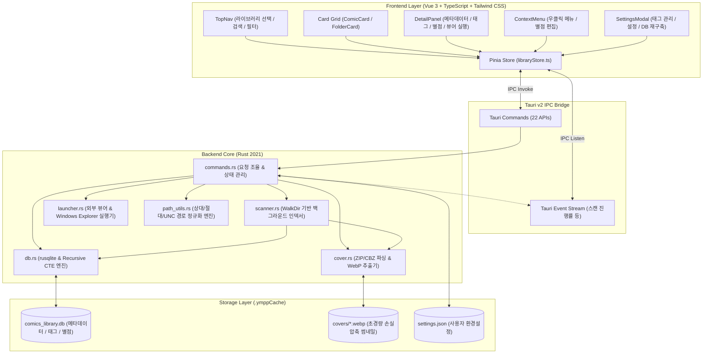

# YMPP Comics Library - Architecture & Implementation Specification

> **문서 버전**: 1.0  
> **최종 수정일**: 2026-10-24  
> **기준 코드베이스**: `D:\Repository\UhHeuLibrary`  
> **관련 문서**: [기획서.md](file:///d:/Repository/UhHeuLibrary/기획서.md), [Gemini.md](file:///d:/Repository/UhHeuLibrary/Gemini.md)

---

## 1. 시스템 개요 (System Overview)

**YMPP Comics Library**는 로컬 디스크 및 SMB/WebDAV 네트워크 드라이브(UNC 경로)에 보관된 만화책 아카이브(ZIP/CBZ)를 관리, 인덱싱, 탐색, 실행하는 초경량 데스크톱 애플리케이션입니다.

### 1.1 핵심 설계 원칙 (Core Architectural Principles)

1. **무손실 원본 보존 (Non-Destructive)**: 원본 만화 압축 파일(ZIP/CBZ)은 절대로 수정하거나 압축 해제된 상태로 영구 보관하지 않으며, 모든 메타데이터와 표지 캐시는 별도의 독립된 공간에 격리 저장합니다.
2. **완전한 포터블 아키텍처 (True Portability)**:
   - 라이브러리 폴더 내부의 `.ymppCache/` 디렉터리에 SQLite DB(`comics_library.db`)와 WebP 표지 캐시(`covers/`)를 보관합니다.
   - 데이터베이스 내부의 모든 경로는 라이브러리 루트 기준 상대 경로(`relative_path`)로 기록되어, 라이브러리 폴더를 외장 하드, NAS, 다른 PC로 이동해도 메타데이터가 100% 온전히 유지됩니다.
   - 프로그램 실행 파일(`YMPPComicsLibrary.exe`) 역시 단일 파일로 배포되어 어디서 실행하든 상대 경로 기반으로 동작합니다.
3. **네트워크 드라이브(UNC / SMB) 완전 대응**:
   - `\\server\share\comics\` 형태의 Windows UNC 경로를 기본 지원하며, 대괄호(`[]`), 공백, 한글, 특수문자가 포함된 경로에서도 외부 뷰어 실행 및 Windows 파일 탐색기 연동이 오작동 없이 작동합니다.
4. **계층적 태그 상속 (Tag Inheritance Engine)**:
   - 상위 폴더에 태그를 지정하면 하위 모든 하위 폴더 및 만화책 파일에 실시간으로 자동 상속되며, SQLite Recursive CTE를 통해 무결성을 보장합니다.
   - 별점(Rating, 0~5점)은 상속되지 않고 파일/폴더별로 독립 관리됩니다.

---

## 2. 전체 시스템 아키텍처 (System Architecture)



---

## 3. 백엔드 구성요소 상세 (Backend Components)

모든 백엔드 코드는 `src-tauri/src/` 디렉터리에 위치하며, Rust 표준 라이브러리와 네이티브 OS API를 통해 고성능/저지연 처리를 수행합니다.

### 3.1 모듈별 역할 및 책임

| 모듈 파일 | 주요 구조체 / 함수 | 핵심 역할 및 기능 |
| :--- | :--- | :--- |
| [`main.rs`](file:///d:/Repository/UhHeuLibrary/src-tauri/src/main.rs) | `main()` | Tauri 런타임 진입점, `lib::run()` 호출 |
| [`lib.rs`](file:///d:/Repository/UhHeuLibrary/src-tauri/src/lib.rs) | `run()`, `AppState` | Tauri 빌더 구성, `AppState` 전역 상태 등록, 21개 Command 등록 |
| [`models.rs`](file:///d:/Repository/UhHeuLibrary/src-tauri/src/models.rs) | `Library`, `FolderItem`, `ComicFileItem`, `TagItem` 등 | Frontend와 주고받는 모든 직렬화(Serialize/Deserialize) DTO 정의 |
| [`commands.rs`](file:///d:/Repository/UhHeuLibrary/src-tauri/src/commands.rs) | `AppState`, `LibraryContext`, 21개 Tauri Command | 상태 전이, 라이브러리 컨텍스트 동적 전환, IPC 요청 라우팅, 폴더 표지 백그라운드 지연 해석, 개별 항목 리프레시 |
| [`db.rs`](file:///d:/Repository/UhHeuLibrary/src-tauri/src/db.rs) | `Database` | SQLite 지속 연결 풀링, 배치 태그 집계, Recursive CTE 상속 쿼리, 태그 CRUD, DB 재구축 |
| [`scanner.rs`](file:///d:/Repository/UhHeuLibrary/src-tauri/src/scanner.rs) | `Scanner`, `ScanProgress` | 비동기 백그라운드 파일 스캔, 신규 파일(`is_new`) 감지, 표지 생성 큐 관리 |
| [`cover.rs`](file:///d:/Repository/UhHeuLibrary/src-tauri/src/cover.rs) | `CoverExtractor` | ZIP/CBZ 압축 및 낱개 이미지 폴더 파싱, 멀티스레드 병렬 표지 인덱싱, WebP 인코딩, 인메모리 캐시 |
| [`launcher.rs`](file:///d:/Repository/UhHeuLibrary/src-tauri/src/launcher.rs) | `Launcher` | 외부 만화책 뷰어(Honeyview 등) 실행, Windows 탐색기 위치 열기, Windows UNC 접두사 복구 |
| [`path_utils.rs`](file:///d:/Repository/UhHeuLibrary/src-tauri/src/path_utils.rs) | `to_relative_path`, `resolve_to_absolute` | 실행 폴더 및 라이브러리 기준 상대 경로 변환, 네트워크 UNC 드라이브 정규화 |

---

### 3.2 핵심 백엔드 메커니즘 (Key Backend Mechanisms)

#### 1) Windows UNC 네트워크 경로 정규화 및 탐색기 연동 (`launcher.rs`)
* **Windows 커널 UNC 접두사(`\\?\UNC\`) 복구**:
  Windows에서 존재하는 네트워크 경로(`\\server\share\...`)에 대해 Rust `canonicalize()`를 호출하면 `\\?\UNC\server\share\...`로 변환됩니다. 단순 드라이브 처리(`\\?\C:\`) 방식으로 `\\?\`만 잘라내면 `UNC\server\...`가 되어 잘못된 상대 경로로 인식되므로, `strip_prefix(r"\\?\UNC\")`를 감지하여 반드시 **`\\`** 로 재구성합니다.
  ```rust
  if let Some(unc) = s.strip_prefix(r"\\?\UNC\") {
      return format!(r"\\{}", unc).replace('/', "\\");
  }
  ```
* **탐색기 `/select,"<path>"` 인자 분리 (`raw_arg`)**:
  Windows `explorer.exe`는 공백이 있는 파일 경로를 선택할 때 `/select,`는 따옴표 밖에 있고 대상 경로만 따옴표로 감싸진 `/select,"C:\path with space\file.zip"` 형식을 요구합니다. Rust의 기본 `Command::arg()`는 공백이 포함된 인자 전체를 따옴표로 묶어버려 `explorer.exe "/select,..."` 형태로 전달되어 기본 폴더(내 문서)가 열리는 치명적 버그가 발생합니다.
  이를 방지하기 위해 Windows 전용 `CommandExt::raw_arg`를 사용합니다:
  ```rust
  use std::os::windows::process::CommandExt;
  let select_arg = format!(r#"/select,"{}""#, clean_path);
  Command::new("explorer.exe").raw_arg(&select_arg).spawn()
  ```

#### 2) 재귀적 태그 상속 엔진 (`db.rs`)
폴더 계층 구조가 아무리 깊어도 단일 쿼리로 상위 조상 폴더들의 모든 태그를 집계하기 위해 SQLite Recursive CTE를 사용합니다.
```sql
WITH RECURSIVE Ancestors(id, parent_id) AS (
    SELECT id, parent_id FROM folders WHERE id = ?1
    UNION ALL
    SELECT f.id, f.parent_id
    FROM folders f
    JOIN Ancestors a ON f.id = a.parent_id
    WHERE a.parent_id IS NOT NULL AND a.parent_id != 0
)
SELECT DISTINCT t.id, t.name, t.display_name, t.is_system
FROM tags t
JOIN folder_tags ft ON t.id = ft.tag_id
JOIN Ancestors a ON ft.folder_id = a.id
ORDER BY t.display_name ASC;
```

#### 3) SMB 네트워크 드라이브 고속 탐색 최적화
네트워크 드라이브(SMB/UNC) 환경에서 폴더 이동 및 홈 이동 시 발생하던 지연(2~5초)을 제거하기 위해 4중 가속 아키텍처가 적용되었습니다:
1. **지속적 SQLite 연결 풀링 (`conn_pool: Mutex<Connection>`)**:
   - 매 탐색 요청마다 SQLite 연결을 새로 열고 닫으면 SMB 파일 락 핸드셰이크가 반복되어 수백 ms의 지연이 발생합니다.
   - 단일 지속 연결을 메모리 캐시 최적화 PRAGMA(`cache_size = -20000`, `temp_store = MEMORY`, `synchronous = NORMAL`)와 함께 유지합니다.
2. **단일 배치 JOIN 쿼리로 N+1 문제 해결**:
   - 200개 이상의 하위 폴더/파일이 있을 때 각각 태그를 조회하던 루프를 단일 `folder_tags JOIN tags` 배치 쿼리로 치환하여 왕복 지연을 1회로 단축했습니다.
   - 폴더 파일 목록의 상속 태그는 폴더 진입 시 1회만 계산하고 하위 파일들에 공유합니다.
3. **인메모리 표지 캐시 & 파일 목록 색인 (`CoverExtractor`)**:
   - 표지 파일 존재 여부를 디스크/네트워크 `Path::exists()`로 수십 번 확인하지 않고, 앱 기동 시 `.ymppCache/covers/` 디렉터리 항목을 `HashSet<String>`으로 메모리에 사전 색인하여 $O(1)$로 즉시 판별합니다.
   - 이미 로드된 WebP 표지는 Data URL 캐시(`HashMap<String, String>`)에 유지하여 불필요한 디스크 I/O를 원천 차단합니다.
4. **멀티스레드 병렬 표지 읽기 (`std::thread::scope`)**:
   - 캐시된 WebP 파일들을 디스크에서 읽어올 때 최대 8스레드 병렬 처리를 통해 수십 개의 표지를 수 밀리초 내에 로드합니다.

#### 4) 낱개 이미지 폴더 및 시리즈 폴더 썸네일 지원
* **폴더 표지 우선순위 추출 알고리즘**:
  1. 캐시된 폴더 전용 표지(`folder_{id}.webp`) 확인.
  2. 하위 만화책 파일(ZIP/CBZ)이 존재할 경우 해당 만화책 표지를 폴더 표지로 고속 복제.
  3. 만화책 압축 파일이 없고 낱개 이미지(`jpg`, `png`, `webp` 등)로만 구성된 폴더인 경우:
     - 폴더 직하 및 최대 2단계 하위 폴더를 스캔하여 이미지 파일 목록 수집.
     - 키워드 우선순위(`cover`, `001`, `01`, `front` 등) 및 자연어 정렬(Natural Sort)을 적용하여 대표 표지 선정.
     - WebP로 변환하여 `.ymppCache/covers/folder_{id}.webp`로 저장.
* **비차단 지연 로딩 (`resolve_folder_covers`)**:
  - 폴더 진입 시 초기 화면은 즉각 렌더링하고, 표지가 아직 없는 폴더들은 프론트엔드가 백그라운드 청크 단위로 비동기 호출하여 점진적으로 표시합니다.

#### 5) SQLite 네트워크 드라이브(SMB) 안전성
SMB/NFS 공유 네트워크 폴더 상에서는 SQLite의 WAL(Write-Ahead Logging) 모드가 공유 메모리(`.db-shm`) 잠금 제약으로 인해 실패할 수 있습니다. `init_schema`에서 WAL 모드 활성화를 시도하고, 네트워크 폴더 제약으로 실패할 경우 자동으로 일반 저널(`DELETE`) 모드로 폴백하여 안정성을 확보합니다.

---

## 4. 프론트엔드 구성요소 상세 (Frontend Components)

프론트엔드는 `src/` 디렉터리에 위치하며 Vue 3 Composition API (`<script setup lang="ts">`), Pinia 스토어, Tailwind CSS로 구현되어 있습니다.

### 4.1 컴포넌트 계층 구조

| 컴포넌트 | 경로 | 주요 역할 |
| :--- | :--- | :--- |
| `App.vue` | [`src/App.vue`](file:///d:/Repository/UhHeuLibrary/src/App.vue) | 최상위 레이아웃 컨테이너 (TopNav, Grid, DetailPanel, StatusBar, Modals 배치) |
| `TopNav.vue` | [`src/components/TopNav.vue`](file:///d:/Repository/UhHeuLibrary/src/components/TopNav.vue) | 라이브러리 폴더 열기, 뒤로/상위 이동, 검색창, 정렬 기준 선택, 설정 열기 |
| `BreadcrumbNav.vue` | [`src/components/BreadcrumbNav.vue`](file:///d:/Repository/UhHeuLibrary/src/components/BreadcrumbNav.vue) | 현재 폴더 계층 경로 표시 및 임의 상위 폴더 원클릭 점프 |
| `FolderCard.vue` | [`src/components/FolderCard.vue`](file:///d:/Repository/UhHeuLibrary/src/components/FolderCard.vue) | 폴더 카드 (표지 썸네일 지원, 폴더 뱃지, 별점, 단일클릭: 상세패널, 더블클릭: 폴더 진입, 220ms 디바운스) |
| `ComicCard.vue` | [`src/components/ComicCard.vue`](file:///d:/Repository/UhHeuLibrary/src/components/ComicCard.vue) | 만화 카드 (표지 썸네일, New 뱃지, 별점, 단일클릭: 상세, 더블클릭: 뷰어 열기) |
| `DetailPanel.vue` | [`src/components/DetailPanel.vue`](file:///d:/Repository/UhHeuLibrary/src/components/DetailPanel.vue) | 상시 노출 상세 패널 (미선택 시 빈 화면 안내, 폴더/만화 썸네일 프리뷰, 태그/별점 편집, 만화 뷰어/탐색기 버튼) |
| `ContextMenu.vue` | [`src/components/ContextMenu.vue`](file:///d:/Repository/UhHeuLibrary/src/components/ContextMenu.vue) | 우클릭 커스텀 메뉴 (열기, 별점 서브메뉴 0~5점, 탐색기 열기, 상세정보 보기) |
| `SettingsModal.vue` | [`src/components/SettingsModal.vue`](file:///d:/Repository/UhHeuLibrary/src/components/SettingsModal.vue) | 설정 모달 (외부 뷰어 등록, 카드 크기 5단계 조절, 태그 검색 시 폴더 태그 포함 옵션, 태그 관리(사용량/수정/삭제), DB 완전 재구축) |
| `StatusBar.vue` | [`src/components/StatusBar.vue`](file:///d:/Repository/UhHeuLibrary/src/components/StatusBar.vue) | 하단 상태 표시줄 (스캔 진행률 바, 항목 통계, 라이브러리 경로 요약) |
| `libraryStore.ts` | [`src/stores/libraryStore.ts`](file:///d:/Repository/UhHeuLibrary/src/stores/libraryStore.ts) | 전역 반응형 상태 관리 및 Tauri IPC 호출 래퍼 |

### 4.2 이벤트 처리 및 사용자 경험 최적화

1. **클릭 / 더블클릭 경합 방지 (220ms 디바운스)**:
   단일 클릭 시 우측 상세 정보 패널이 로드되고, 더블클릭 시 폴더 진입 또는 만화책 실행이 일어납니다. Vue 카드 컴포넌트 내부에서 `clickTimer`를 관리하여, 첫 번째 클릭으로 인한 DOM 리렌더링이 두 번째 클릭 이벤트를 삼키지 않도록 보호합니다.
2. **커스텀 다크 컨텍스트 메뉴**:
   기본 브라우저 웹뷰의 우클릭 메뉴를 차단(`@contextmenu.prevent`)하고, 만화책 관리에 최적화된 다크 테마 커스텀 메뉴를 띄웁니다.
3. **인라인 Base64 썸네일 렌더링**:
   Tauri의 커스텀 에셋 프로토콜 대신 백엔드에서 WebP 바이너리를 읽어 즉시 `data:image/webp;base64,...` 데이터 URL로 프론트엔드에 전달함으로써 보안 정책이나 로컬/네트워크 경로 권한 문제 없이 부드럽게 렌더링합니다.

---

## 5. 데이터베이스 스키마 명세 (Database Schema Specification)

데이터베이스 파일: `<library_root>/.ymppCache/comics_library.db`

```sql
PRAGMA foreign_keys = ON;

-- 1. 라이브러리 테이블
CREATE TABLE IF NOT EXISTS libraries (
    id INTEGER PRIMARY KEY AUTOINCREMENT,
    root_path TEXT NOT NULL UNIQUE,
    created_at TEXT NOT NULL,
    updated_at TEXT NOT NULL,
    last_scanned_at TEXT
);

-- 2. 폴더 테이블 (상대 경로 기반)
CREATE TABLE IF NOT EXISTS folders (
    id INTEGER PRIMARY KEY AUTOINCREMENT,
    library_id INTEGER NOT NULL,
    relative_path TEXT NOT NULL,
    name TEXT NOT NULL,
    parent_id INTEGER,
    rating INTEGER NOT NULL DEFAULT 0,
    last_scanned_at TEXT,
    UNIQUE(library_id, relative_path),
    FOREIGN KEY(library_id) REFERENCES libraries(id) ON DELETE CASCADE,
    FOREIGN KEY(parent_id) REFERENCES folders(id) ON DELETE SET NULL
);

-- 3. 만화책 파일 테이블 (상대 경로 기반)
CREATE TABLE IF NOT EXISTS comic_files (
    id INTEGER PRIMARY KEY AUTOINCREMENT,
    folder_id INTEGER NOT NULL,
    relative_path TEXT NOT NULL UNIQUE,
    name TEXT NOT NULL,
    extension TEXT NOT NULL,
    size INTEGER NOT NULL DEFAULT 0,
    modified_at TEXT NOT NULL,
    created_at TEXT NOT NULL,
    rating INTEGER NOT NULL DEFAULT 0,
    comment TEXT NOT NULL DEFAULT '',
    is_new INTEGER NOT NULL DEFAULT 1,
    status TEXT NOT NULL DEFAULT 'active',
    FOREIGN KEY(folder_id) REFERENCES folders(id) ON DELETE CASCADE
);

-- 4. 태그 마스터 테이블
CREATE TABLE IF NOT EXISTS tags (
    id INTEGER PRIMARY KEY AUTOINCREMENT,
    name TEXT NOT NULL UNIQUE,
    display_name TEXT NOT NULL,
    is_system INTEGER NOT NULL DEFAULT 0
);

-- 5. 매핑 테이블
CREATE TABLE IF NOT EXISTS comic_tags (
    comic_file_id INTEGER NOT NULL,
    tag_id INTEGER NOT NULL,
    PRIMARY KEY(comic_file_id, tag_id),
    FOREIGN KEY(comic_file_id) REFERENCES comic_files(id) ON DELETE CASCADE,
    FOREIGN KEY(tag_id) REFERENCES tags(id) ON DELETE CASCADE
);

CREATE TABLE IF NOT EXISTS folder_tags (
    folder_id INTEGER NOT NULL,
    tag_id INTEGER NOT NULL,
    PRIMARY KEY(folder_id, tag_id),
    FOREIGN KEY(folder_id) REFERENCES folders(id) ON DELETE CASCADE,
    FOREIGN KEY(tag_id) REFERENCES tags(id) ON DELETE CASCADE
);

-- 6. 표지 캐시 테이블
CREATE TABLE IF NOT EXISTS cover_caches (
    comic_file_id INTEGER PRIMARY KEY,
    cache_path TEXT NOT NULL,
    file_modified_at TEXT NOT NULL,
    extracted_at TEXT NOT NULL,
    status TEXT NOT NULL DEFAULT 'ready',
    error TEXT,
    FOREIGN KEY(comic_file_id) REFERENCES comic_files(id) ON DELETE CASCADE
);
```

---

## 6. 빌드 및 배포 파이프라인 (Build & Release Pipeline)

* **배포 자동화 스크립트**: [`build_release.bat`](file:///d:/Repository/UhHeuLibrary/build_release.bat)
* **산출물 위치**: [`release/YMPPComicsLibrary.exe`](file:///d:/Repository/UhHeuLibrary/release/YMPPComicsLibrary.exe) (약 7.1 MB 독립 실행 파일)

### 6.1 원자적 파일 교체 (Atomic Executable Replacement)
Windows 파일 시스템(NTFS)에서는 실행 중인 프로세스의 `.exe` 파일에 덮어쓰기(`copy`)를 시도하면 공유 위반(`Sharing Violation`) 에러가 발생합니다. 하지만 실행 중인 파일의 이름 바꾸기(`move`)는 허용되는 NTFS의 특성을 활용하여, 프로그램이 실행 중인 상태에서도 안전하게 새 빌드를 덮어쓸 수 있도록 스크립트가 구현되어 있습니다:
```bat
if exist "release\YMPPComicsLibrary.exe" (
    copy /y "src-tauri\target\release\ympp-comics-library.exe" "release\YMPPComicsLibrary.exe" > nul 2>nul
    if errorlevel 1 (
        move /y "release\YMPPComicsLibrary.exe" "release\YMPPComicsLibrary.exe.old" > nul 2>nul
        copy /y "src-tauri\target\release\ympp-comics-library.exe" "release\YMPPComicsLibrary.exe" > nul
    )
)
```

---

## 7. 향후 개발 로드맵 (Future Roadmap)

본 프로젝트는 기획서의 단계별 지침에 따라 모듈화되어 있으며, 다음 단계 확장을 고려하여 인터페이스가 설계되어 있습니다:

* **Phase 2: 로컬 임베딩 및 AI 문맥 검색**
  - Ollama 연동 (로컬 LLM/임베딩 모델: `embeddingGemma` 등)
  - SQLite 내 벡터 테이블 또는 sqlite-vec 확장 모듈 도입
  - 자연어 시맨틱 쿼리 ("학원물 일상 만화 찾아줘") 기능 연동
* **Phase 3: OCR 대사 검색 및 시각 이해**
  - 만화 페이지 내부 말풍선 텍스트 OCR 추출 및 전문(Full-Text) 검색 인덱싱
  - Vision 모델 기반 그림체/구도 유사도 검색
* **Phase 4: 추가 아카이브 포맷 지원**
  - CBR (RAR 압축), CB7 (7-Zip 압축), PDF 만화 포맷 파서 확장
