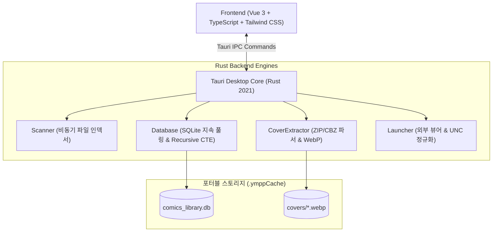

# 📚 YMPP Comics Library

<p align="center">
  
</p>

<p align="center">
  <strong>대용량 로컬 디스크 및 SMB/WebDAV 네트워크 드라이브(UNC 경로)를 위한 초경량 고성능 포터블 만화책 아카이브 뷰어</strong>
</p>

<p align="center">
  <a href="https://github.com/siz20971/ympp-comics-library/releases"></a>
  
  
  
  
  
  
</p>

---

## 🌟 개요 (Overview)

**YMPP Comics Library**는 테라바이트급 대용량 로컬 드라이브 및 NAS(SMB / WebDAV / Windows UNC) 상의 만화책 아카이브(`ZIP`, `CBZ`, 낱개 이미지 폴더)를 원본 손상 없이 초경량으로 인덱싱, 탐색, 태깅, 평가(별점), 검색 및 외부 뷰어로 실행할 수 있는 데스크톱 애플리케이션입니다.

Tauri v2 및 Rust 네이티브 엔진을 기반으로 설계되어 메모리 사용량을 최소화하고, 수만 권의 만화책도 수 밀리초 만에 부드럽게 탐색합니다.

---

## ✨ 주요 기능 (Key Features)

### 🚀 1. 초경량 네이티브 실행
- 별도의 런타임이나 번거로운 인스톨러 없이 **단일 포터블 실행 파일(`YMPPComicsLibrary.exe`, 약 7.5 MB)**로 즉시 구동됩니다.
- 저사양 PC나 원격 데스크톱 환경에서도 가볍고 민첩하게 동작합니다.

### 💾 2. 100% 무손실 포터블 아키텍처 (Non-Destructive)
- 원본 만화 압축 파일은 절대로 압축 해제하거나 변경하지 않습니다.
- 라이브러리 루트 내의 숨김 디렉터리 **`.ymppCache/`**에만 SQLite 데이터베이스(`comics_library.db`)와 WebP 표지 캐시(`covers/`)를 보존합니다.
- 만화책 폴더를 다른 외장하드, USB, NAS로 통째로 이동해도 메타데이터와 표지 캐시가 영구적으로 보존됩니다.

### 🌐 3. 완벽한 Windows UNC 네트워크 드라이브 지원
- `\\server\share\comics\`와 같은 Windows UNC 경로 및 네트워크 드라이브(WebDAV)를 완벽하게 지원합니다.
- 파일명에 포함된 대괄호(`[]`), 한글, 특수문자, 공백 경로를 정규화하여 외부 만화책 뷰어(꿀뷰 등) 및 Windows 탐색기 위치 선택 열기(`/select,`)가 오작동 없이 작동합니다.

### 🏷️ 4. 지능형 계층적 태그 상속 (Tag Inheritance Engine)
- 상위 폴더에 태그를 지정하면 하위의 모든 폴더 및 만화책 파일에 실시간으로 **자동 상속**됩니다.
- SQLite Recursive CTE를 활용하여 폴더 트리가 아무리 깊어도 단일 쿼리로 상속 태그를 고속 계산합니다.
- 별점(Rating, 0~5점)은 상속되지 않고 파일 및 폴더마다 독립적으로 관리됩니다.

### 🖼️ 5. 고속 썸네일 & 낱개 이미지 폴더 감지
- ZIP/CBZ 압축 파일 내부의 표지 이미지를 자동 추출하여 고효율 WebP 형식으로 인덱싱합니다.
- 압축되지 않은 **낱개 이미지 폴더**도 자연어 정렬(Natural Sort) 및 키워드 우선순위(`cover`, `001`, `front` 등)를 통해 자동으로 대표 표지를 식별합니다.
- 지연 로딩(Lazy Loading) 및 메모리 캐시를 적용하여 수천 개의 썸네일이 즉각 반응합니다.

### 🔍 6. 유연한 검색 및 필터링
- 파일명 검색, 태그 필터링, 별점 필터링을 지원합니다.
- 폴더 자체를 검색 결과에 함께 표시하는 옵션(`폴더 포함 검색`)을 제공하여 시리즈 단위로 빠르게 접근할 수 있습니다.

---

## 🏗️ 시스템 아키텍처 (Architecture)



---

## 🛠️ 기술 스택 (Tech Stack)

| 구분 | 기술 / 라이브러리 |
| :--- | :--- |
| **Desktop Core** | [Tauri v2](https://v2.tauri.app/) (Rust 기반 고성능 경량 웹뷰 셸) |
| **Backend Engine** | Rust 2021 (`rusqlite`, `image`, `zip`, `tokio`, `walkdir`, `open`) |
| **Database** | SQLite 3 (Bundled, Recursive CTE, WAL/Journal 자동 폴백) |
| **Frontend** | [Vue 3](https://vuejs.org/) (Composition API, `<script setup lang="ts">`) |
| **Language** | [TypeScript](https://www.typescriptlang.org/) |
| **Styling** | [Tailwind CSS v4](https://tailwindcss.com/), [Lucide Icons](https://lucide.dev/) |
| **State Management** | [Pinia](https://pinia.vuejs.org/) |
| **Build Tool** | [Vite](https://vitejs.dev/) |

---

## 📥 다운로드 및 실행 방법 (Download & Run)

1. [Releases](https://github.com/siz20971/ympp-comics-library/releases) 페이지에서 최신 버전의 **`YMPPComicsLibrary.exe`**를 다운로드합니다.
2. 원하는 위치(예: 바탕화면, 만화책 디스크 루트 등)에 두고 실행합니다.
3. 상단 바의 **폴더 아이콘**을 클릭하여 만화책(ZIP/CBZ)이 담긴 디렉터리를 선택하면 자동으로 인덱싱이 시작됩니다.

---

## 🎮 주요 조작 가이드

- **폴더 진입**: 폴더 카드 더블 클릭 또는 엔터 키
- **상위 폴더 이동**: 상단 뒤로가기 버튼 또는 브레드크럼 경로 클릭
- **만화책 열기**: 만화책 카드 더블 클릭 또는 우측 상세 패널의 '만화책 열기' 클릭 (기본 뷰어 연결)
- **상세 정보 확인**: 카드 1회 클릭 시 우측 패널에 메타데이터, 상속 태그, 별점, 경로 즉시 표시
- **우클릭 컨텍스트 메뉴**:
  - 즉시 열기
  - 빠른 별점 지정 (0~5점)
  - Windows 탐색기 위치 열기 (파일 선택 상태로 표시)
- **환경 설정 (우측 상단 톱니바퀴)**:
  - 사용자 지정 외부 뷰어(.exe) 등록 (예: 꿀뷰, 네이버 웹툰 뷰어 등)
  - 카드 썸네일 크기 5단계 슬라이더 조절
  - 태그 검색 시 폴더 포함 검색 On/Off
  - 전역 태그 이름 일괄 수정 / 삭제
  - DB 및 표지 캐시 완전 재구축

---

## 💻 개발 및 빌드 (Development & Build)

### 요구사항
- [Node.js](https://nodejs.org/) (v18 이상)
- [Rust](https://rustup.rs/) (v1.75 이상)
- [Visual Studio C++ Build Tools](https://visualstudio.microsoft.com/visual-cpp-build-tools/)

### 개발 모드 실행
```powershell
# 의존성 설치
npm install

# 프론트엔드 + Tauri 동시 개발 모드 실행
npm run tauri dev
```

### 테스트 실행
```powershell
# Rust 단위 테스트 실행 (CTE 상속, UNC 경로 정규화, 자연어 정렬 등)
cargo test --manifest-path src-tauri/Cargo.toml
```

### 단일 포터블 실행 파일 빌드
```powershell
# 프론트엔드 컴파일 + Rust 릴리즈 최적화 빌드 자동화 스크립트
cmd /c build_release.bat
```
빌드가 완료되면 `release/YMPPComicsLibrary.exe` 파일이 생성됩니다.

---

## 📄 라이선스 (License)

본 프로젝트는 [MIT License](LICENSE)에 따라 배포됩니다.
자유롭게 수정 및 재배포할 수 있습니다.
